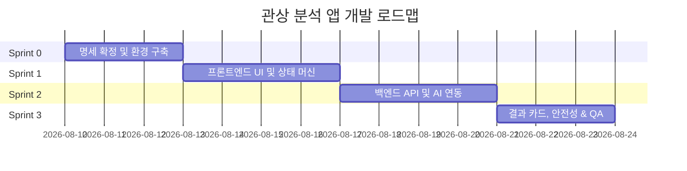

# 관상 분석 앱 개발 계획서 (Development Plan)

> **최종 수정일**: 2026-08-07  
> **관련 문서**: [PRD.md](file:///c:/face-app/docs/PRD.md)  
> **목적**: PRD(`docs/PRD.md`)에 정의된 관상 분석 앱 요구사항을 순차적이고 효율적으로 개발 완료하기 위한 스프린트 단위 개발 계획 수립

---

## 1. 개요 및 추진 전략

### 1.1 프로젝트 핵심 요약
- **목적**: 사진 1장으로 오락 목적의 관상 해석 카드를 즉석에서 제공하며, 사용자가 화면을 캡처해 공유할 수 있는 웹 서비스
- **핵심 구조**: 단일 페이지 앱 (1 Page, 5가지 상태 전이 Architecture)
- **보안 및 개인정보**: 사용자 클라이언트에 AI API Key 노출 금지 (Backend API Route Proxy), 선택된 사진은 서버/DB 저장 없이 메모리 상에서 분석 후 즉시 폐기 (F-06)

### 1.2 미결 사항 (PRD 부록 A) 기본 대응 가이드라인
개발 정체를 방지하기 위해 PRD 부록 A의 미결 질문에 대해 다음과 같이 기본 사양을 가정하고 착수하며, 명세 작성 시 최종 확정합니다.

| ID | 항목 | 기본 결정 내용 (Sprint 0에서 확정) |
|---|---|---|
| **Q-A** | 허용 이미지 형식 | JPG, PNG, WEBP (+ 클라이언트 단 HEIC 자동 변환 지원) |
| **Q-B** | 용량 / 해상도 상한 | 용량 10MB 이하, 해상도 최대 4096x4096 (초과 시 클라이언트 압축/리사이징) |
| **Q-C** | 다중 얼굴 처리 | ① 거절 후 "1명의 얼굴이 명확히 나온 사진을 올려주세요" 안내 (E-04) |
| **Q-D** | 분석 타임아웃 | 12초 (성공조건 S-2 15초 만족을 위해 12초 초과 시 E-05 타임아웃 처리) |
| **Q-E** | 금지 표현 검증 (E-09) | 프롬프트 제약(1차) + 백엔드 JSON 검증 필터링(2차) 하이브리드 적용 |
| **Q-F** | 결과 카드 레이아웃 | 모바일 스크린 1회 스크롤 이내 캡처 가능한 카드형 레이아웃 |
| **Q-G** | 금지 표현 표본 검사 | 테스트 케이스 30개 표본 대조 (S-4 검증) |

---

## 2. 스프린트 단위 개발 로드맵

전체 개발은 **총 4개의 스프린트 (Sprint 0 ~ Sprint 3)** 로 나누어 순차 진행합니다.

---

### 🎨 Sprint 0: 명세 확정 및 기초 개발 환경 구축
> **목표**: 미결 명세 문서 작성 완료 및 프로젝트 베이스라인 구축

#### [주요 작업]
1. **상세 명세 문서 작성 (핸드오프 조건 달성)**
   - `02_UI-SPEC.md`: 5가지 상태(A~E)별 상세 레이아웃, 문구, 로딩/에러 UI 및 모바일 스크롤/캡처 사양 명세
   - `03_ANALYSIS-SPEC.md`: AI 프롬프트 설계, 관상 분석 결과 JSON 구조 확정 (Q1 해결)
   - `04_API-SPEC.md`: `/api/analyze` 엔드포인트 요청/응답 스키마, 타임아웃, 에러 코드 정의
   - `06_BACKLOG.md`: 세부 에픽 및 이슈 단위 작업 분해
2. **프로젝트 환경 설정**
   - Next.js (App Router) 기반 기본 아키텍처 및 상태 관리 패턴 정의
   - 공통 UI 컴포넌트, 테마 및 CSS 스타일 가이드 구축

#### [완료 조건 (DoD)]
- [ ] PRD 5.3 핸드오프 조건 1~5번 항목 서류 완비 (`02`, `03`, `04`, `06` SPEC 작성 완료)
- [ ] 개발 환경 실행 및 빌드에 에러가 없음

---

### 📱 Sprint 1: 프론트엔드 상태 머신 & 핵심 UI 개발
> **목표**: 단일 페이지 내 5가지 상태 전이(State A~E) 및 UI 기반 기능 완성

#### [주요 작업]
1. **단일 페이지 상태 머신 (State Machine) 구축**
   - `State A (고지·동의)` → `State B (사진 선택)` → `State C (분석 중)` → `State D (결과)` / `State E (에러)` 전이 로직 작성
2. **사전 고지 및 동의 기능 (F-01 / US-01 / E-01)**
   - 3가지 핵심 고지(오락 목적 / 사진 미저장 / 타인 사진 무단 업로드 금지) 노출
   - 명시적 동의 체크 전에는 사진 선택 버튼 비활성화 (E-01)
3. **사진 선택 및 클라이언트 미리보기 (F-02 / US-02 / E-02, E-03)**
   - 기기 사진 선택, 선택된 사진 미리보기, 사진 교체 기능 구현
   - 클라이언트 1차 검증: 지원 형식 검사(E-02), 용량/해상도 체크(E-03)
4. **다시하기 & 이탈 처리 (F-05 / US-06 / E-08)**
   - D/E 상태에서 B 상태(사진 선택)로 1회 조작 복귀 (F-05)
   - 분석 중 새로고침/화면 이탈 시 A 상태 초기화 처리 (E-08)

#### [완료 조건 (DoD)]
- [ ] 동의 전 사진 선택 불가 동작 검증
- [ ] 사진 선택 - 미리보기 - 교체 과정이 오류 없이 동작
- [ ] D/E 상태에서 1-Click 조작으로 B 상태 복귀 확인

---

### 🤖 Sprint 2: 백엔드 API Proxy 및 AI 관상 분석 엔진 연동
> **목표**: API Key 보안을 준수하는 Backend Proxy 및 AI 분석 연동, 예외 처리 완성

#### [주요 작업]
1. **안전한 Backend API Proxy 연동 (F-03 / US-03 / 5.2 제약 6)**
   - Serverless API Route (`/api/analyze`) 구축
   - Client에서 API Key 직접 노출을 완전 차단하고 서버 환경변수로 관리
2. **AI 관상 분석 연동 & 결과 구조화 (F-03 / 03_ANALYSIS-SPEC)**
   - AI Vision API 모델 연동 및 구조화된 JSON 데이터 출력(Structured Outputs) 설정
   - 응답 스키마 검증(E-06): 필수 결과 필드 누락 시 에러 처리
3. **사진 미저장 및 즉시 폐기 처리 (F-06 / 5.2 제약 7)**
   - 사진 데이터를 디스크나 DB에 저장하지 않고 메모리 버퍼(Buffer) 상에서 AI API로 전송 후 즉시 해제
4. **백엔드 예외 처리 및 타임아웃 (E-04, E-05, E-07)**
   - 얼굴 미검출 / 다중 얼굴 검출 처리 (E-04)
   - 12초 타임아웃 처리 및 분석 엔진 장애/한도 초과 에러 핸들링 (E-05, E-07)

#### [완료 조건 (DoD)]
- [ ] 사용자의 네트워크 탭/클라이언트 코드에 AI API Key가 노출되지 않음
- [ ] 서버 저장소에 업로드된 사진 파일 경로가 전혀 없음 (메모리 전송)
- [ ] 타임아웃, 스키마 오류, 얼굴 미검출 시 적절한 E 상태로 전이됨

---

### ✨ Sprint 3: 결과 카드 렌더링, 안전성 검증 및 최종 QA
> **목표**: 결과 카드 UX 완성, 금지 표현 가드레일 적용, 성공 지표 및 E2E 검증

#### [주요 작업]
1. **결과 카드 렌더링 & 캡처 최적화 (F-04 / US-04)**
   - JSON 응답 기반의 직관적이고 매력적인 관상 해석 카드 UI 렌더링
   - 오락 목적 고지 문구 상시 동시 노출
   - 모바일 1회 스크롤 이내 캡처가 용이하도록 컴팩트 레이아웃 구성
2. **결과 문구 제약 검증 (E-09 / S-4 / PRD §4.4)**
   - 5대 금지 표현 (외모 비하, 인종/성별/나이 단정, 불행/수명 예언, 서열화/점수, 과학적 사실 주장) 프롬프트 가드레일 및 후처리 필터 적용
   - 금지 표현 위반 시 결과를 노출하지 않고 E 상태로 안전 전이
3. **성공 조건(S-1~S-4) & E2E 통합 테스트**
   - S-2 응답 시간 측정 (중앙값 15초 이내)
   - S-4 금지 표현 표본 30건 생성 후 검증 (0건 달성)
   - 모바일 브라우저(iOS Safari, Android Chrome) 실기기 호환성 및 캡처 테스트

#### [완료 조건 (DoD)]
- [ ] A → B → C → D 전체 시나리오가 모바일 실기기에서 끊김 없이 동작
- [ ] 금지 표현 표본 대조 시 위반 사항 0건
- [ ] E-01 ~ E-09 예외 상황 발생 시 빈 화면/먹통 없이 모두 E 상태 안내로 처리됨

---

## 3. PRD 완료 조건 (Definition of Done) 대조표

| 구분 | 완료 조건 | 검증 방식 | 담당 스프린트 |
|---|---|---|---|
| **기능** | A → B → C → D 흐름 실기기 동작 | 모바일 브라우저 E2E 테스트 | Sprint 1~3 |
| **기능** | F-01 ~ F-06 기능 완전 구현 | 단위/통합 테스트 | Sprint 1, 2, 3 |
| **기능** | E-01 ~ E-09 예외 처리 완비 | 예외 모의 발생(Mocking) 테스트 | Sprint 1, 2, 3 |
| **보안** | 인증 정보 클라이언트 미노출 | 소스코드 & 네트워크 패킷 감시 | Sprint 2 |
| **개인정보** | 원본 사진 저장 경로 0개 | 서버 코드 Audit & 스토리지 검증 | Sprint 2 |
| **품질** | 금지 표현(PRD §4.4) 0건 준수 | 30개 테스트 표본 검증 (S-4) | Sprint 3 |

---

## 4. 리스크 및 대응 방안

1. **AI 분석 타임아웃 또는 지연 (S-2 지표 미달 가능성)**
   - *대응*: 이미지 전송 전 클라이언트 단에서 용량/해상도 축소(Resizing) 후 전송하여 AI 처리 속도 향상
2. **AI의 금지 표현 환각 (Hallucination)**
   - *대응*: 프롬프트 단 strict rule 지정 + 백엔드 응답 검증 필터(regex/keyword) 이중 가드레일 적용
3. **HEIC 등 아이폰 특수 포맷 업로드 문제**
   - *대응*: `heic2any` 라이브러리를 활용하여 B 상태 사진 선택 시 브라우저에서 Canvas/JPEG로 자동 변환 처리
