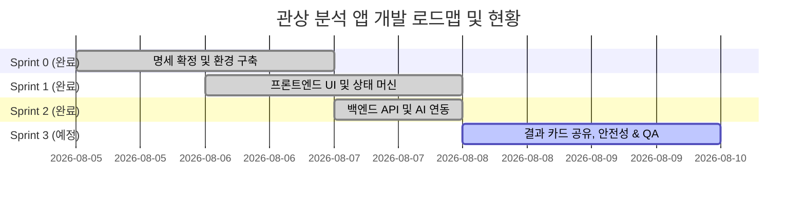

# 관상 분석 앱 개발 계획서 (Development Plan)

> **최종 수정일**: 2026-08-07  
> **상태**: **최신화 완료 (Sprint 3 SNS 공유 기능 계획 반영)**  
> **관련 문서**: [PRD.md](file:///c:/face-app/docs/PRD.md), [02_UI-SPEC.md](file:///c:/face-app/docs/02_UI-SPEC.md), [03_ANALYSIS-SPEC.md](file:///c:/face-app/docs/03_ANALYSIS-SPEC.md), [04_API-SPEC.md](file:///c:/face-app/docs/04_API-SPEC.md), [06_BACKLOG.md](file:///c:/face-app/docs/06_BACKLOG.md)

---

## 1. 개요 및 현재 진행 현황

### 1.1 프로젝트 현황 요약
- **진행 상황**: Sprint 0, Sprint 1, Sprint 2 (백엔드 API Proxy 및 AI Vision 관상 분석 연동) **개발 완료**
- **구현된 핵심 소스 파일**:
  - `app/api/analyze/route.ts`: Serverless API Proxy (Gemini 3.6 Flash Vision 모델 연동, Structured Outputs, E-02~E-07 예외 및 E-09 금지 표현 후처리, 15초 타임아웃, 메모리 상 즉시 버퍼 폐기 F-06)
  - `app/page.tsx`: 실제 `/api/analyze` 백엔드 API 연동 및 State A~E 전이
  - `components/screen-result.tsx`: 동적 관상 분석 JSON 데이터 렌더링
  - `components/screen-shell.tsx` & `screen-consent.tsx` & `screen-select.tsx` & `screen-analyzing.tsx` & `screen-error.tsx`: 5가지 화면 상태 UI

---

## 2. 스프린트 단위 개발 현황 및 로드맵

---

### 🎨 Sprint 0: 명세 확정 및 기초 개발 환경 구축 ✅ [완료]
- [x] PRD 핸드오프 조건 달성: `02_UI-SPEC.md`, `03_ANALYSIS-SPEC.md`, `04_API-SPEC.md`, `06_BACKLOG.md` 작성 완료
- [x] Next.js App Router, Tailwind CSS, OKLCH 테마 및 CSS 스타일 가이드 구축

---

### 📱 Sprint 1: 프론트엔드 상태 머신 & 핵심 UI 개발 ✅ [완료]
- [x] 단일 페이지 상태 머신 (`State A` ~ `State E`) 전이 로직 작성 (`app/page.tsx`)
- [x] 사전 고지 및 동의 기능 (`ScreenConsent` - US-01, F-01, E-01)
- [x] 사진 선택 및 클라이언트 미리보기 (`ScreenSelect` - US-02, F-02, E-02, E-03)
- [x] 분석 중 로딩 애니메이션 (`ScreenAnalyzing` - US-03, C 상태)
- [x] 결과 카드 UI 및 오락 배지 렌더링 (`ScreenResult`, `FunBadge` - US-04, F-04)
- [x] 에러 화면 및 메시지 대응 (`ScreenError` - US-05, E-04~E-07)
- [x] 다시하기 & 상태 복귀 처리 (`page.tsx` `backToSelect` - US-06, F-05, E-08)

---

### 🤖 Sprint 2: 백엔드 API Proxy 및 AI 관상 분석 엔진 연동 ✅ [완료]
- [x] **안전한 Backend API Proxy 연동 (`/api/analyze`)**: Client API Key 직접 노출 완전 차단 및 환경변수 관리
- [x] **AI Vision 모델 연동 & 결과 구조화**: Gemini 3.6 Flash 모델 연동 및 `ResultData` Structured Outputs JSON 반환
- [x] **사진 미저장 및 즉시 폐기 처리 (F-06 / 5.2 제약 7)**: 파일 디스크 저장 없이 메모리 `Buffer` 전송 후 즉시 해제
- [x] **백엔드 예외 처리 및 타임아웃 (E-04, E-05, E-06, E-07)**: 얼굴 미검출(422), 15초 타임아웃(504), 할당량 초과(429), 스키마 오류(500) 핸들링
- [x] **금지 표현 2차 후처리 필터 적용 (E-09)**: PRD §4.4 5대 금지 항목 정규식/키워드 검사 후 부적절 결과 파기

---

### ✨ Sprint 3: 결과 카드 SNS 공유, 안전성 검증 및 최종 QA ⏳ [다음 단계]
> **목표**: 결과 카드 UX 완성, Web Share API 및 이미지/링크 공유 기능 구현(F-07), 성공 지표 및 E2E 검증

#### [주요 작업]
1. **결과 카드 SNS 공유 & 이미지 다운로드 개발 (F-07 / US-07)**
   - 결과 카드를 Canvas 이미지(PNG)로 변환하는 클라이언트 캡처 엔진 구축 (`html2canvas` / Canvas API)
   - 모바일 표준 `navigator.share`를 통한 카카오톡, 인스타그램, 트위터(X) 등 네이티브 공유 팝업 연동
   - 카드 이미지 다운로드 및 서비스 링크 복사(토스트 알림) 구현
2. **성공 조건(S-1~S-4) & E2E 통합 테스트**
   - S-2 응답 시간 측정 (중앙값 15초 이내)
   - S-4 금지 표현 표본 30건 생성 후 검증 (0건 달성)
   - 모바일 브라우저(iOS Safari, Android Chrome) 실기기 호환성 및 캡처/공유 테스트

---

## 3. PRD 완료 조건 (Definition of Done) 대조표

| 구분 | 완료 조건 | 검증 방식 | 현황 |
|---|---|---|---|
| **기능** | A → B → C → D 흐름 실기기 동작 | 모바일 브라우저 E2E 테스트 | ✅ E2E 연결 완료 |
| **기능** | F-01 ~ F-06 기능 완전 구현 | 단위/통합 테스트 | ✅ F-01~F-06 구현 완료 |
| **기능** | F-07 SNS 공유 및 이미지 저장 | Web Share API 및 다운로드 테스트 | ⏳ Sprint 3 진행 예정 |
| **기능** | E-01 ~ E-09 예외 처리 완비 | 예외 모의 발생(Mocking) 테스트 | ✅ E-01~E-09 구현 완료 |
| **보안** | 인증 정보 클라이언트 미노출 | 소스코드 & 네트워크 패킷 감시 | ✅ Backend Proxy 완료 |
| **개인정보** | 원본 사진 저장 경로 0개 | 서버 코드 Audit & 스토리지 검증 | ✅ 메모리 버퍼 폐기 준수 |
| **품질** | 금지 표현(PRD §4.4) 0건 준수 | 30개 테스트 표본 검증 (S-4) | ⏳ Sprint 3 최종 검증 |
